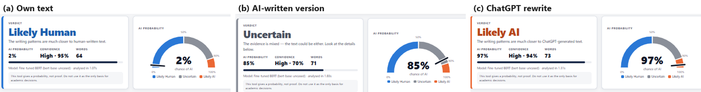

# DetectAI — An Explainable BERT-Based System for Detecting AI-Generated Text

**MSc Data Science & Analytics · 3rd semester · Natural Language Processing (24MSDA3S04) · Jain University**

DetectAI estimates how likely an English text was written by ChatGPT rather than a person, and **shows why**.
Paste a text into the web page and you get:

- a verdict — **Likely Human**, **Uncertain** or **Likely AI** — with a calibrated AI probability and a confidence level,
- **word-level evidence** (orange = pushed towards AI, blue = pushed towards human, Gradient × Input on BERT),
- a probability for **every sentence** and for **every paragraph** (useful for half-human, half-AI texts),
- a **writing-style panel** (sentence-length variation, vocabulary richness, part-of-speech ratios) compared with typical human and AI texts,
- a warning when the text is under 50 words and too short to judge reliably.

> This tool gives a probability, not proof. Do not use it as the only basis for academic decisions.



---

## Key results (held-out test set, 1,335 texts)

| Model | Accuracy | Precision | Recall | F1 | ROC-AUC |
|---|---|---|---|---|---|
| Bag of Words + Naive Bayes | 0.813 | 0.818 | 0.802 | 0.810 | 0.912 |
| TF-IDF + Logistic Regression (stopwords removed) | 0.870 | 0.844 | 0.903 | 0.873 | 0.954 |
| TF-IDF + Logistic Regression (stopwords kept) | 0.890 | 0.853 | 0.939 | 0.894 | 0.967 |
| Character n-gram TF-IDF + linear SVM | 0.882 | **0.955** | 0.799 | 0.870 | 0.956 |
| Stylometric features + Logistic Regression | 0.662 | 0.611 | 0.877 | 0.720 | 0.759 |
| **Fine-tuned BERT (bert-base-uncased)** | **0.945** | 0.915 | **0.979** | **0.946** | **0.993** |

Classical baselines: `results/baseline_metrics.json`. BERT: `results/bert_metrics_v1.json` (Colab, Tesla T4).

- BERT gains most on short, informal **Q&A answers** (accuracy 0.904 vs 0.802 for the best classical model).
- After temperature scaling (T = 2.455) and validation-based thresholds, **95.2%** of AI test texts are labelled *Likely AI*
  and **6.2%** of human test texts (target: at most 5% on validation data).
- A deletion test shows BERT's word highlights beat random words for **56%** of texts — a rough guide, not proof.

---

## Folder structure

```
DetectAI/
├── run.bat                      ← double-click to start the website
├── backend/
│   ├── app.py                   ← FastAPI server (REST API + serves the website)
│   ├── detector.py              ← prediction engine: BERT or baseline, verdicts, explanations
│   ├── preprocessing.py         ← cleaning, tokenization, stopwords, lemmatization, style features
│   ├── requirements.txt         ← pinned package versions
│   └── models/
│       ├── detectai-bert/       ← fine-tuned BERT (download from Releases, see below)
│       ├── tfidf_lr.joblib      ← TF-IDF + Logistic Regression (stopwords kept)
│       ├── char_svm.joblib      ← character n-gram TF-IDF + linear SVM
│       ├── other_baselines/     ← Naive Bayes, LR without stopwords, stylometric LR
│       ├── thresholds*.json     ← temperature and verdict thresholds
│       └── style_reference.json ← typical human / AI writing-style values
├── frontend/                    ← index.html, style.css, app.js (the website, no external libraries)
├── scripts/                     ← dataset building, augmentation, training, robustness, calibration, checks
├── notebooks/                   ← Colab notebook for BERT fine-tuning (+ executed copy with outputs)
├── data/                        ← final dataset, augmented texts, score caches
├── results/                     ← metrics (JSON), misclassified examples, figures/
└── report/                      ← report figures and screenshots
```

---

## Dataset sources and credits

The corpus (8,895 texts: 4,490 human, 4,405 ChatGPT) combines two public datasets. All credit for the original texts goes to their authors.

- **Ghostbuster** — Verma, V., Fleisig, E., Tomlin, N., & Klein, D. (2024). *Ghostbuster: Detecting text ghostwritten by large
  language models.* NAACL 2024. Human and ChatGPT student essays, WritingPrompts stories and Reuters news.
  Data: https://github.com/vivek3141/ghostbuster-data
- **HC3** — Guo, B., et al. (2023). *How close is ChatGPT to human experts? Comparison corpus, evaluation, and detection.*
  Human and ChatGPT answers (Reddit ELI5, open QA, Wikipedia CS, finance, medicine).
  Data: https://huggingface.co/datasets/Hello-SimpleAI/HC3

A data audit (`scripts/data_audit.py`) found and fixed seven collection artefacts (token-probability files, tokenised spacing,
literal "\n", curly quotes, maths markup, length differences, Reddit markdown) before any model was trained.
The split is stratified on label × domain: 6,226 train, 1,334 validation, 1,335 test.

---

## Setup and run on Windows

**You need:** Windows 10/11, Python 3.13 (from python.org — tick *"Add python.exe to PATH"*), about 3 GB of free disk space
and 8 GB RAM for BERT.

1. Clone or download this repository.
2. Download the trained BERT model (next section) — without it the website uses the classical fallback model.
3. Double-click **`run.bat`**.
   - First time only: it creates a virtual environment and installs the pinned packages (needs internet, 5–15 minutes).
   - It then starts the server and opens **http://127.0.0.1:8000** in your browser.
4. Keep the command window open while using the website; close it to stop the server.

Manual alternative in Command Prompt:

```bat
python -m venv venv
venv\Scripts\python -m pip install -r backend\requirements.txt
venv\Scripts\python -m uvicorn backend.app:app --host 127.0.0.1 --port 8000
```

To force the classical baseline (e.g. on a laptop with little RAM), run `set DETECTAI_FORCE_BASELINE=1` and then `run.bat`
in the same Command Prompt window.

---

## Download the trained BERT model

The fine-tuned model (~420 MB) is too large for a Git repository, so it is published as a release asset.

1. Open the repository's **Releases** page: https://github.com/khushis0503/DetectAI/releases
2. Download **`detectai-bert-model.zip`**.
3. Unzip it into `backend/models/` so that the files end up in **`backend/models/detectai-bert/`**
   (`config.json`, `model.safetensors`, `tokenizer.json`, `tokenizer_config.json`, `training_args.bin`).
4. Start `run.bat`; the page header then shows "Fine-tuned BERT (bert-base-uncased)".

---

## Retraining BERT on Google Colab

1. Open https://colab.research.google.com → *File → Upload notebook* → `notebooks/DetectAI_BERT_Training_Colab.ipynb`.
2. *Runtime → Change runtime type → T4 GPU*.
3. *Runtime → Run all*. When the upload step asks for files, upload:
   `data/detectai_dataset.csv`, `data/train_augmented.csv`, `results/baseline_metrics.json`, `results/robustness.json`
   and `scripts/augment.py`.
4. Fine-tuning takes about 10–11 minutes on a T4 (the whole notebook about 25 minutes). The last step saves the model and
   results as `detectai_bert_outputs.zip` and downloads it in parts; rejoin them with the `copy /b` command the notebook prints.
5. Put the `detectai_bert_model` folder at `backend/models/detectai-bert/`, then recalibrate:
   ```bat
   venv\Scripts\python scripts\calibrate.py
   venv\Scripts\python scripts\saliency_check.py
   ```

`notebooks/DetectAI_BERT_Training_Colab_executed.ipynb` contains the outputs of our own Colab run.

### Rebuilding the dataset and baselines from the raw corpora (optional)

```bat
git clone --depth 1 https://github.com/vivek3141/ghostbuster-data raw
venv\Scripts\python -c "from huggingface_hub import hf_hub_download; hf_hub_download('Hello-SimpleAI/HC3','all.jsonl',repo_type='dataset',local_dir='raw/hc3')"
venv\Scripts\python -m nltk.downloader punkt punkt_tab stopwords wordnet averaged_perceptron_tagger_eng
venv\Scripts\python scripts\build_dataset.py
venv\Scripts\python scripts\augment.py
venv\Scripts\python scripts\train_baselines.py
venv\Scripts\python scripts\robustness_test.py
venv\Scripts\python scripts\calibrate.py
venv\Scripts\python scripts\saliency_check.py
```

---

## API

| Method | Path | Description |
|---|---|---|
| POST | `/api/predict` | body `{"text": "..."}` → verdict, probability, confidence, highlights, sentence and paragraph scores, style |
| GET | `/api/health` | server status and loaded model |
| GET | `/api/model-info` | model name, thresholds, temperature, test-set metrics |

Input rules: 5–3,000 words; under 50 words the result carries a "less reliable" warning and reduced confidence.

## Team 02
Khushi S, Akhila, Kalpana
